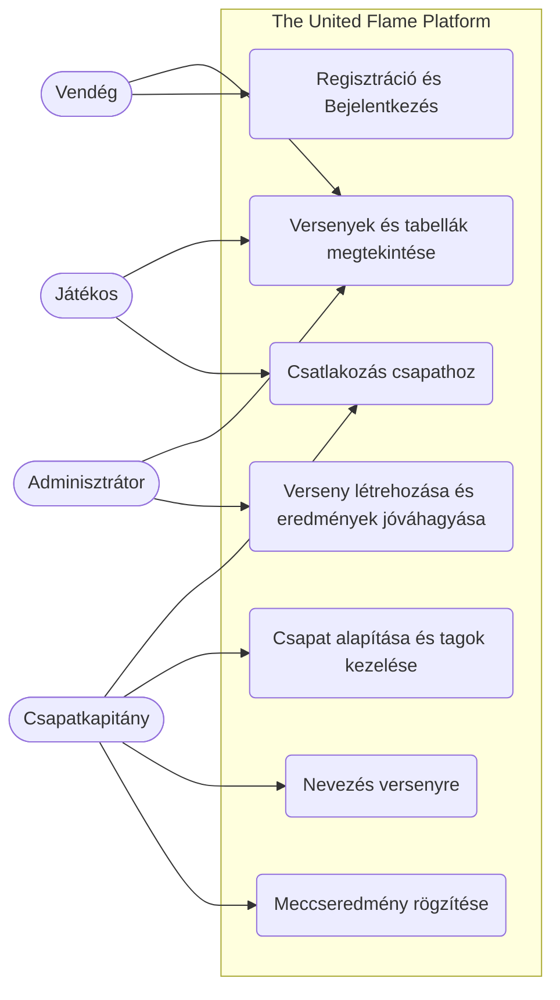

# VIZSGAREMEK / PROJEKTDOLGOZAT – RENDSZERÁTTEKINTÉS ÉS KÖVETELMÉNYEK

| Dokumentum adatok | Részletek |
| :--- | :--- |
| **Projekt hivatalos címe** | **The United Flame** – E-sport Verseny- és Csapatkezelő Webalkalmazás |
| **Dokumentum típusa** | 1. Rész: Rendszeráttekintés és Követelményspecifikáció |
| **Készítő diák neve** | [Dobos László & Szalka László György] |
| **Képzés / Szakma** | 13. évfolyam – Szoftverfejlesztő és -tesztelő technikus |
| **Oktatási Intézmény** | [Hengersor] |
| **Konzulens tanár** | [Bencze István] |
| **Készítés** | 2026. november 17. |
| **GitHub Repository** | `git@github.com:DLaszlo64/MesterMunka.git` |

---

## 1. Cél és problémafelvetés

A hazai amatőr és félprofi e-sport közösségekben a versenyek szervezése gyakran széttagolt felületeken (Discord szervereken, Excel táblázatokban) zajlik, ami átláthatatlan nevezésekhez, lassú eredménykövetéshez és adminisztrációs hibákhoz vezet.

A **The United Flame** webalkalmazás célja egy központosított, modern platform létrehozása, amely automatizálja a csapatkezelést, a bajnokságokra való jelentkezést, valamint a mérkőzések eredményeinek rögzítését és a ranglisták valós idejű frissítését.

---

## 2. Felhasználói szerepkörök (Actors)

* **Vendég (Nem regisztrált látogató):** Megtekintheti a nyilvános versenyeket, a regisztrált csapatok profilját, a mérkőzéseredményeket és a ranglistákat.
* **Játékos (Regisztrált felhasználó):** Létrehozhatja saját játékosprofilját, csatlakozhat meglévő csapatokhoz meghívó/jelentkezés alapján, és követheti saját statisztikáit.
* **Csapatkapitány (Team Captain):** Saját e-sport csapatot alapíthat, kezelheti a csapattagok névsorát (felvétel, eltávolítás), nevezheti a csapatot versenyekre, és rögzítheti a lejátszott meccsek eredményeit.
* **Rendszeradminisztrátor (Admin):** Teljes körű jogosultsággal rendelkezik: új versenyeket hozhat létre, jóváhagyhatja vagy felülbírálhatja a vitás meccseredményeket, valamint moderálhatja a felhasználókat és csapatokat.

---

## 3. Követelményspecifikáció

### Funkcionális követelmények (MoSCoW prioritásokkal)

| ID | Követelmény megnevezése | Rövid leírás | Prioritás |
| :--- | :--- | :--- | :--- |
| **FK-01** | Felhasználói hitelesítés | Regisztráció, bejelentkezés és jogosultságkezelés JWT token alapon. | **Must have** |
| **FK-02** | Csapatkezelés (CRUD) | Csapat létrehozása, adatainak módosítása, tagok meghívása és törlése. | **Must have** |
| **FK-03** | Versenyek és nevezés | Aktuális kupák listázása, csapatok nevezése szabad helyek függvényében. | **Must have** |
| **FK-04** | Meccseredmények rögzítése | Eredmények feltöltése a csapatkapitányok által, adminisztrátori jóváhagyással. | **Should have** |
| **FK-05** | Élő ranglista (Leaderboard) | Csapatok automatikus pontszámítása és rangsorolása játékok (pl. CS2, Valorant) szerint. | **Should have** |
| **FK-06** | Értesítési rendszer | Rendszerüzenetek küldése csapatmeghívókról és közelgő mérkőzésekről. | **Could have** |

### Nem-funkcionális követelmények

* **Teljesítmény és válaszidő:** A REST API végpontok válaszideje átlagos terhelés mellett nem haladhatja meg a 200 ms-ot; a kliensoldali oldalbetöltés 1,5 másodperc alatt megtörténik.
* **Biztonság:** Jelszavak tárolása kizárólag `bcrypt` sózott hash formátumban; HTTPS protokoll használata; SQL Injection és XSS támadások elleni védelem, valamint szerepkör-alapú hozzáférés-vezérlés (RBAC).
* **Reszponzivitás és UI/UX:** Mobilbarát, reszponzív megjelenés (Mobile-First elv), amely okostelefonon, tableten és asztali monitoron egyaránt hibátlanul használható.
* **Skálázhatóság és karbantarthatóság:** Moduláris, rétegzett kódfelépítés, amely lehetővé teszi új e-sport címek későbbi integrálását.

---

## 4. Globális Use Case Diagram



---

## 5. Rendszerarchitektúra vázlat

A rendszer klasszikus háromrétegű (3-tier) kliens-szerver architektúrára épül, ahol a megjelenítési, az üzleti és az adatréteg élesen elkülönül egymástól:

```text
+-----------------------+       HTTP/HTTPS (JSON)       +---------------------------+       SQL Lekérdezések       +--------------------+
|                       |  -------------------------->  |                           |  -------------------------->  |                    |
|  React Kliens (SPA)   |                               |  Node.js / Express API    |                               |   SQL Adatbázis    |
|  (Frontend Réteg)     |  <--------------------------  |  (Üzleti Logika Réteg)    |  <--------------------------  |   (Adat Réteg)     |
+-----------------------+       JWT + REST Válasz       +---------------------------+       Rekordok (ORM)         +--------------------+
```

* **React Kliens (SPA):** Egyoldalas alkalmazás (Single Page Application), amely a felhasználói felületet biztosítja, kezeli a kliensoldali útválasztást, és `axios`/`fetch` hívásokkal kommunikál a szerverrel.
* **Node.js / Express REST API:** Fogadja a kliens HTTP kéréseit, ellenőrzi a JWT tokeneket, validálja a bejövő adatokat, végrehajtja az üzleti logikát, és egységes JSON válaszokat küld vissza.
* **SQL Adatbázis (MySQL / PostgreSQL):** Relációs adatbázis-kezelő, amely a felhasználók, csapatok, versenyek és mérkőzések adatait konzisztens, normalizált táblákban tárolja.