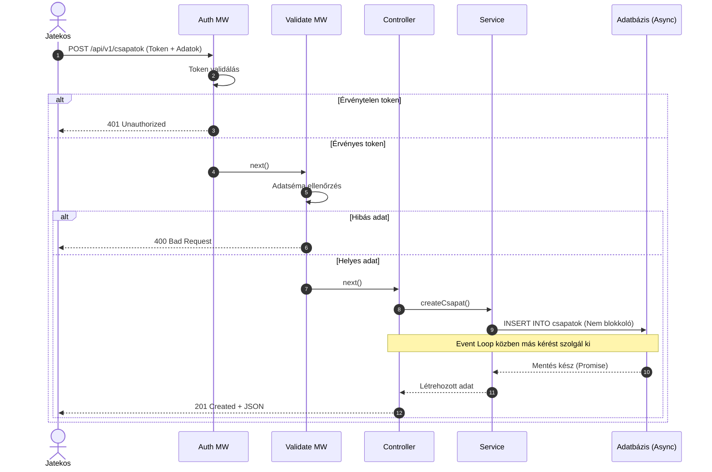

**VIZSGAREMEK / PROJEKTDOLGOZAT – BACKEND RENDSZERTERV**

| Dokumentum adatok | Részletek |
| :--- | :--- |
| **Projekt hivatalos címe** | **The United Flame** – E-sport Verseny- és Csapatkezelő Webalkalmazás Backend Rendszerterve és API Dokumentációja |
| **Dokumentum típusa** | Szoftverarchitektúra és Műszaki Rendszerterv (Vizsgaremek Dokumentáció) |
| **Készítő diák neve** | [Dobos László & Szalka László György] |
| **Szakma** | 13. évfolyam – Szoftverfejlesztő és -tesztelő technikus |
| **Intézmény címe** | [Hengersor] |
| **Konzulens tanár | [Benzce István] |
| **Készítés** | 2026. november 17. |
| **GitHub Repository** | `git@github.com:DLaszlo64/MesterMunka.git` |

---

## 1. Technológiai elemzés: Node.js és Express.js

A **The United Flame** e-sport oldal backendjéhez a Node.js és Express.js párost választottuk az alábbi okok miatt:
* **Eseményhurok (Event Loop):** Egyszálú, aszinkron működés, amely minimális memóriával képes sok egyidejű kérést kiszolgálni (pl. esti meccsek alatt).
* **Nem blokkoló I/O:** Az adatbázis-műveletek a háttérben futnak (`libuv`), így a szerver nem akad el a válaszadás közben, hanem kiszolgálja a többi felhasználót.
* **Middleware lánc:** Moduláris "futószalag" az Express-ben a kérések előszűrésére (hitelesítés, validálás, hibakezelés).

---

## 2. Mappastruktúra és rétegzettség

A kód átláthatósága érdekében tiszta, rétegzett architektúrát használunk:

```text
src/
├── config/       # Adatbázis és .env beállítások
├── routes/       # Útvonalak (pl. csapat.routes.js)
├── middlewares/  # Előszűrők (auth, validate, error)
├── controllers/  # HTTP kérés/válasz kezelés
├── services/     # Üzleti logika
└── models/       # Adatbázis sémák
```
* **Middleware:** Biztonsági ellenőrzések és bemenet-validáció.
* **Route:** URL-ek összekötése a Controllerrel.
* **Controller:** HTTP kommunikáció (req/res kezelés, státuszkódok).
* **Service:** Üzleti szabályok és adatbázis-kezelés.

---

## 3. REST API Végpont-specifikáció (Csapatok)

Az API alapja az `/api/v1` előtag és a JSON formátum.

| HTTP Metódus | Végpont | Bemenet (Query / URL / Body) | Sikeres válasz (Státuszkód + JSON Minta) |
| :--- | :--- | :--- | :--- |
| **GET** | `/api/v1/csapatok` | `?jatek=CS2&limit=10` | **200 OK**<br>`{ "success": true, "data": [{ "id": "tuf-01", "nev": "Flame Guardians" }] }` |
| **GET** | `/api/v1/csapatok/:id` | `id` (URL param) | **200 OK**<br>`{ "success": true, "data": { "id": "tuf-01", "nev": "Flame Guardians", "pontszam": 1450 } }` |
| **POST** | `/api/v1/csapatok` | **Headers:** `Bearer <token>`<br>**Body:** `{ "nev": "Phoenix", "tag": "PHX", "jatek": "Valorant" }` | **201 Created**<br>`{ "success": true, "data": { "id": "tuf-02", "nev": "Phoenix" } }` |
| **PUT** | `/api/v1/csapatok/:id` | **Headers:** `Bearer <token>`<br>**Body:** `{ "nev": "Phoenix Updated" }` | **200 OK**<br>`{ "success": true, "data": { "id": "tuf-02", "nev": "Phoenix Updated" } }` |
| **DELETE** | `/api/v1/csapatok/:id` | **Headers:** `Bearer <token>` | **200 OK**<br>`{ "success": true, "message": "Csapat törölve." }` |

**Hibakezelés (Státuszkódok):**
* `400 Bad Request` – Hibás adatok / hiányzó mező.
* `401 Unauthorized` – Nincs bejelentkezve (nincs token).
* `403 Forbidden` – Nincs jogosultsága a művelethez.
* `404 Not Found` – Nem található az erőforrás.
* `500 Internal Server Error` – Szerverhiba.

---

## 4. Szekvencia diagram (Új csapat regisztrációja)

